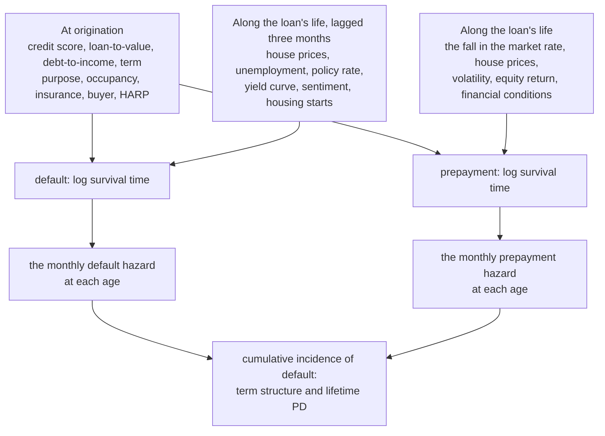

# Model

## In short

| | |
|---|---|
| Family | Weibull accelerated failure time, shape <!-- value: model.rho --> -- chosen by [rule 2](rules.md), not by likelihood |
| Competing risk | Prepayment, modelled as its own cause-specific hazard. **The published PD below is still `1 - S` on the default hazard alone** -- see the warning under the table |
| Twelve-month PD, origination book today | **<!-- value: scenario.pd_12m -->** |
| Lifetime PD over 36 months, baseline | <!-- value: scenario.baseline --> |
| Lifetime PD over 36 months, adverse | <!-- value: scenario.adverse --> |
| Adverse against baseline | **<!-- value: scenario.multiple -->** |

!!! danger "The published figures are `1 - S`, not a cumulative incidence"
    This page claimed the opposite until 17 October 2026, when the second independent validation
    found that the competing-risk machinery is **written and tested but never called**:
    `competing_paths`, `lifetime_incidence` and `incidence_term_structure` exist in
    `models/lifetime_pd.py`, and nothing hands the projection views a second fit, so the numbers
    in the table above come from `1 - S` on the default hazard alone.

    What that costs is measurable without any model, by comparing Kaplan-Meier against
    Aalen-Johansen on the development half: `1 - S` overstates cumulative default by **31% at
    three years, 57% at five, 122% at ten and 201% at fifteen**. And 36 months is not the life of
    a thirty-year mortgage. The wiring, the horizon and the maturity truncation are
    [the second round's plan](second_round_plan.md); until they land, read the figures above as
    what they are.

**Two hazards, not one, and the lifetime PD should be a cumulative incidence.** A loan that repays
cannot later default, so treating repayment as censoring assumes it is uninformative about
default -- and on this book it is the opposite of uninformative: there are 33,797,300
prepayments against 1,671,207 defaults, twenty times as many exits through the door the model
used to ignore. The lifetime PD ought therefore to be the Aalen-Johansen quantity, the share that has
left through default by a given age with the competition accounted for, rather than `1 - S` from
a single hazard, which overstates it at long horizons.

The prepayment model is selected by the same procedure under its own declared priors -- a credit
score that lengthens survival shortens the time to repayment, so the two sets of priors cannot be
one -- and what survives says what one would hope: the fall in the market rate since origination
at -0.198 per standard deviation and equity volatility at -0.215 are its largest effects, while
inflation, its change, volatility change and sentiment were all eliminated for turning their
signs. A refinancing is decided by the rate on offer, not by the business cycle at large. The
record is in the [prepayment selection](reports/selection_weibull_prepayment.md).

## Reading a coefficient

This is an **accelerated failure time** model: a coefficient acts on the logarithm of
survival *time*. **Positive lengthens survival and lowers risk.** `exp(coef)` is a time ratio,
not a hazard ratio; reading it as one inverts every conclusion.

Coefficients are not comparable across covariates measured in different units, so the
continuous ones are shown as the effect of one standard deviation, exposure-weighted on the
training half. The categorical ones are each level against its reference.

<!-- figure: coefficients -->

??? abstract "Every coefficient, with its standard error and interval"
    <!-- table: coefficients -->

??? warning "Three readings to hold loosely"
    - *Financial conditions* (`financial_conditions`) is **no longer in this model**: step 10
      removed it at -0.0155 per standard deviation, under the 0.02 of rule 3, which had named it
      in advance. It survives in the prepayment block.
    - *Policy rate change since origination* (`policy_rate_change`) has no declared prior, and
      rule 15 **withdraws it as a candidate** for that reason: a policy rate above where the loan
      was written lengthens survival here, which reads as the central bank cutting into recessions
      rather than as a payment channel a fixed-rate mortgage does not have -- and the second
      validation measured what that reading costs. The term lowered the predicted hazard 33% in
      2023 and 36% in 2024, about **80% of the level drift** since 2021, and on the 2022 regime
      cut it is the difference between 1.420 and 0.959. It is still in the published model until
      the selection that removes it has run.
    - Housing carries two covariates, the position, *loan-to-value change since origination*
      (`ltv_change`), and the construction cycle, *housing starts growth* (`housing_starts_growth`). The stability step separates a pair only when the smaller one
      changes sign, and neither did.

## The term structure

Cumulative PD month by month for the origination book dated to today -- the commonest
origination profiles, each weighted by the lending it stands for -- on the baseline path, by
segment.

<!-- figure: term_structure -->

Two portfolios can share a lifetime PD and differ entirely here, and the difference decides
when losses arrive.

## Scenarios

The adverse path is shaped like 2008 rather than scaled to it, and it moves every series a
model reads and no series one does not -- across **both** hazards, which is eleven of them. That
is not a tidiness point: when the default model lost inflation to a sign reversal, the scenario
went on shocking the consumer price index for a model that could not feel it, while four of the
eight covariates of the hazard competing with default stood still under stress. The baseline is a random walk from the last observation: **not a forecast**,
but what makes the relative effect of a scenario readable without a view on the economy.

<!-- table: adverse_legs -->

Because the covariates are time-varying, a scenario is applied by projecting the covariate
paths from today and chaining the conditional survival, not by rescoring frozen covariates.

<!-- figure: scenarios -->

??? abstract "Scenarios by segment, as a table"
    <!-- table: scenario_summary -->

!!! warning "What these PDs are not"
    **Prepayment is treated as independent censoring**, so a loan that prepays is assumed to
    have gone on defaulting at the model's hazard. Prepayment is a competing risk, and
    ignoring it overstates lifetime PD, most at long horizons. There is no LGD or EAD, so no
    expected loss.

## Where to read more

- [Calibration report](reports/calibration.md): generated by `creditsurv report`; marginal
  effects on twelve-month PD, and the distribution of lifetime PD under each scenario.
- [Calibration & backtest](calibration.md): whether the hazard behind these numbers matches
  what happened.
