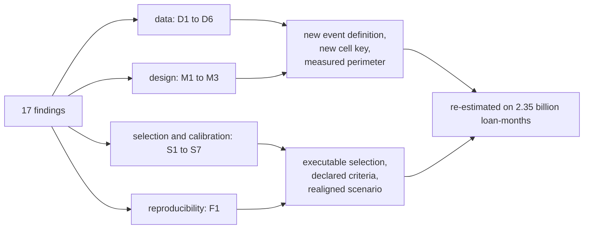

# Validation response

An independent validation of the model at commit `ae582e5` (12 September 2026) raised
**seventeen** findings: six on the data (D), three on the model design (M), seven on selection and
calibration (S) and one on reproducibility (F). **Five** were rated high: **D1**, forbearance
counted as default; **D2**, the moratorium fields discarded at ingest; **M1**, a two-month calendar
misattribution; **S1**, a backtest with no criterion; and **S2**, a stress scenario that did not
move the covariates the model reads.

This page said thirteen findings and three high until 17 October 2026, when the second validation
round pointed out that its own first-round summary had miscounted and that this page had inherited
the number. The arithmetic in the sentence above gives it away: six and three and seven and one
are seventeen. All seventeen were addressed, and every model was re-estimated on the whole
training half, without sampling.

| Finding | What changed | Measured | Evidence |
|---|---|---|---|
| **D1, D2** moratoria counted as defaults | A moratorium is not a default (`MoratoriumPolicy`); the three fields that identify one are kept at ingest. `exclude` chosen over `censor` by a rule written before either fit | May 2020 default rate from 90.4 to **2.00 bp**; censoring would have lost 26% of the test window's defaults | [Moratorium report](reports/moratorium.md), [data preparation](data_preparation.md#a-moratorium-is-not-a-default) |
| **D3** late entries | Measured and warned about, not absorbed | -- | [Data preparation](data_preparation.md#loans-enter-late-and-the-likelihood-is-told) |
| **D4** incomplete cases | Profiled over every vintage: almost all are HARP refinances, which carry no debt-to-income | 18% of the 2009Q2 to 2019Q1 loans, 2.9 times the default rate; stated as outside the model | [Data](data.md#what-is-out-of-scope) |
| **D5** exit codes 16 and 96 | Classified as censoring, and what that rests on measured | 90.1% of reperforming sales had defaulted first | [Data preparation](data_preparation.md#event-definition) |
| **D6** `super_conforming_flag` | Mapped from what the field holds | -- | [Data dictionary](data_dictionary.md) |
| **M1** calendar two months late | The exact origination month in the cell key | 0 of 1,536,686 defaults filed in a different month; the correlation peaks at lag zero | [Data preparation](data_preparation.md#the-grouping-key) |
| **M2** two grids of cut points | One production grid, held by a test to a subset of the exploratory one | -- | [Data preparation](data_preparation.md#cut-points) |
| **M3** loan characteristics kept out of the key | Mortgage insurance and buyer type in the key and screened into the model | 1.19 times the cells, where sixteen had been claimed | [Variable selection](variable_selection.md#running-it-creditsurv-select) |
| **F1, S5** the specification could not be regenerated; levels as calendar effects | `creditsurv select` runs steps 5 to 9 and produces the specification, which a test holds the configuration to; gap forms offered beside levels; the reversal rule runs | 7 macro covariates kept; equity volatility and inflation removed by the procedure | [Methodology](methodology.md#how-the-covariates-were-chosen), [selection record](reports/selection.md) |
| **S1** a backtest with no criterion | Acceptance criteria declared before the run; in-sample actual over expected by year beside the out-of-time figure | Overall ratio and Gini pass; **deciles fail** | [Calibration & backtest](calibration.md) |
| **S2** scenario misaligned | The adverse path moves only series a model reads, and every series a model reads -- now across **both** hazards, since the lifetime PD chains two. Its table is built from the scenario rather than described beside it | 11 series shocked, 11 covariates moved, neither set larger than the other | [Model](model.md#scenarios) |
| **S3** family and shape untested | Distribution comparison with a sign check, and the shape test on occupancy, both run | The log-logistic leads on likelihood; the shape varies with occupancy | [Methodology](methodology.md#the-distribution-family) |
| **S4, S6, S7** lags, marginal effects, figures | Every macro series lagged; marginal effects and event count fixed; figures aligned across documents | -- | [Data](data.md), [portfolio](portfolio.md) |

The measured column records the figures of the re-estimation that closed the findings.
The current figures are on the pages linked beside them.

## Found along the way

- **The block fit engine.** A stock lifelines fit needs 45 to 50 GB on the exact key; fits
  now run block by block on lifelines' own likelihood, polished to the optimum lifelines'
  optimiser stops up to 5.9 standard errors short of.
- **An undamped warm start** stepped into the region where lifelines' clipped likelihood goes
  negative and could have reported it as the optimum; the polish is now damped and refuses
  values no likelihood can take, which also took a screening fit from 76 minutes to 30.
- **The selection's inputs no longer come from its output**, and `report` starts its fit
  where the selection ended.
- **lifelines' clipped likelihood is unbounded below, and every optimiser finds it.** The
  interval probability is clipped at 1e-25 while the left-truncation term is added unclipped, so
  the objective -- a mean negative log-likelihood, which cannot be negative -- can fall below
  anything a likelihood can take. It needs no extreme parameter: on the prepayment model the
  truncation term has only to reach 0.0176 on the mean, the order of the hazard itself. A
  nested fit is now handed its parent's optimum as a floor, that region is returned as infinite
  with a zero gradient so every method backtracks from it, and the shape is bounded at 3 on the
  log scale, where 125 converged fits on this book put it between 1.07 and 1.62.
- **A fit was not reproducible.** One queue served every worker process, so the parent added
  their shares in the order they arrived; floating-point addition is not associative, and the
  optimiser turned the last digit into a different search. Two runs of one fit agreed to every
  printed digit for eighty evaluations, split at 0.065288491918 against 0.065288491919, and were
  five significant figures apart forty later. The shares are added in the parts' own order now,
  and a test compares three runs bit for bit.
- **A diagnosis that did not survive its own test**, recorded because it is easy to reach
  again: that a polish stalling 557 standard errors out means a flat direction. The two
  quantities the comparison needed are identically equal, so the ratio reads one whatever the
  curvature. What the stall meant was the floor above.

## The second round, 17 October 2026

A second independent validation read the model at commit `56ffa88` and did something the first
did not: it **reproduced the published numbers with a scorer that imports nothing from this
package** -- the FRED panel, the covariates and both families' interval probability rewritten from
scratch in DuckDB, covering all 91,575,827 cells in 28 seconds. It found **zero discrepancies**:
the actual-over-expected by year, the deciles, the anchoring multiplier, the test window, the
three regime cuts and the master scale all agree to the fourth digit, and the project's own suite
passes. Of the seventeen first-round findings, **fourteen are closed** including all five high
ones, two are partial and one is reopened.

Then it said the model is **not yet fit for professional use as a lifetime PD or a stress model**,
and said where. That judgement, and what is being done about it, is the current state of this
project.

| Use | Verdict | What blocks it |
|---|---|---|
| Research, benchmark, challenger model | **fit** | — |
| Portfolio risk ranking | with reservations | within-year Gini 0.52-0.55 out of sample, falling for ten years |
| 12-month PD, performing pools (IFRS 9 stage 1) | **not yet** | the level drifts; the master scale holds 1 of 8 grades |
| Lifetime PD (IFRS 9 stage 2) | **not fit** | `1 - S` at 36 months, a weak prepayment model, 2 of 7 age bands out of sample *on the model as it then stood*, no payment state |
| Stress testing and scenarios | **not fit** | unemployment attenuated threefold, a rate proxy with no sign, calendar levels |
| Regulatory PD (IRB) | out of scope | a different default definition, horizon, floors and data requirements |

### The six high findings, and what each is

**The level depends on the regime, and one multiplier cannot hold it.** Actual over expected reads
0.458, 0.823 and 1.420 on the three declared cuts -- two outside the band, in opposite directions
-- and anchored month by month on the test window it falls from 1.386 to 0.771, the last month
already out of band. The overall figure passes partly because errors of opposite sign cancel.
[Rule 4](rules.md) now carries monthly monitoring and a declared recalibration rule.

**`policy_rate_change` is a cycle proxy with no expected sign, and it produces the 2023-24
under-prediction.** It lowered the predicted hazard 33% in 2023 and 36% in 2024, is about **80% of
the level drift** since 2021, and on the 2022 cut is the difference between 1.420 and 0.959. It
carries 19% of the adverse scenario's stress, where in a stagflation it would *reduce* the PD.
[Rule 15](rules.md) withdraws it as a candidate, because the direction it should take depends on
whether rates rose with growth or with inflation and this model does not observe which.

**The moratorium kept in estimation attenuates unemployment threefold.** The coefficient on
*unemployment change since origination* reads −0.0920 at the 2018 cut and −0.0305 at 2021-12: four
points of unemployment multiply the hazard by 1.67 on the first and 1.18 on the second. The
largest unemployment shock in the series arrives with defaults suspended by law, and the
coefficient records it. [Rule 1](rules.md) now puts a regime indicator on 2020-03 to 2021-09 in
the protected block.

**The age structure does not hold out of sample: 2 of 7 bands.** The model under-predicts the
12-to-35-month hump by up to 44% and over-predicts the seasoned book by a third. For a lifetime PD
the shape along age is the product itself. [Rule 16](rules.md) admits a flexible baseline in
log(age) in the scale block, which costs zero cells because age is already in the calendar key.

**The published lifetime PD is `1 - S` over 36 months**, not a cumulative incidence and not a
lifetime. Measured with no model, by Kaplan-Meier against Aalen-Johansen on the development half,
`1 - S` overstates cumulative default by **31% at three years, 57% at five, 122% at ten**. The
competing-risk machinery is written and tested in `models/lifetime_pd.py` and never called.
[Model](model.md) now says so where it used to claim the opposite.

**Three generated reports describe a model that no longer exists.** Generated 17 September, with
old covariate names, no HARP level, one backtest cut and prepayment as censoring, while the main
pages linked to them. They were regenerated on 19 October 2026 and are back in their own
sections; [what was superseded, and when](reports/superseded.md) records the gap, and a test now
holds every generated report to the configured formula **and shape** -- which is the half the
third round found still open.

### What the round also found, and it is the better news

**The candidate from [rule 14](rules.md) passes.** The validator wrote its decision on the
in-sample decile-1 exception **before** computing any out-of-sample number, accepted it on
materiality, and then read the test window: the log-logistic with the shape on the nine
origination covariates reads anchored actual over expected **0.927**, Gini **0.548** and **10 of 10
deciles in band**. It is the first model in this project to pass all three of
[rule 5](rules.md)'s criteria out of time, and its master scale errs to +13% where the published
model errs to +89%.

**And it falsified a prediction this repository had recorded.** [The register](rules_register.md)
holds the reasoning: the in-sample decile-1 miss was 83% the 2019-2021 originations, the safest
band in its first year under the most benign macro readings on record, so the diagnosis predicted
that an out-of-time decile 1 would under-predict too -- the test window's young loans being the
2022-2024 vintages. It does not: decile 1 reads **1.056**, and the young vintages inside it 1.043
and 0.992. The prediction was written before the window was read, which is the only reason it is
knowable that it was wrong.

### Where the work goes

In [the second round's plan](second_round_plan.md), ordered by what moves a fitness verdict rather
than by what is cheapest. The macro block is on the critical path to **two** of the three, so it
goes first among the modelling work; the documentation and the rules go before it because they
cost nothing and because a reader currently finds three different models. The third validation
round is placed **after the macro block and the one adoption**, not at the end, because the age
baseline and the lifetime PD are built on top of it -- and building them against a specification
that turns out wrong is what happened to the three September reports.

## The third round, 19 October 2026

A third independent validation read the model at commit `f77f440` and again found **zero
discrepancies between published and recomputed**, on its third independent implementation of the
likelihood. Of the second round's eighteen findings, four are closed -- P2, P3, **P7** and C6 --
eight are partly closed and almost all of those are documentation, and six are open, five of them
deferred by the plan to the fourth round. It found **seven new findings, four of them high**.

One verdict moved and one came closer:

| Use | Second round | Third round | What is missing |
|---|---|---|---|
| Research, benchmark, challenger | fit | **fit** | — |
| Portfolio risk ranking | with reservations | with reservations | within-year Gini 0.53-0.55 |
| 12-month PD, performing pools (IFRS 9 stage 1) | not yet | **not yet, closer** | the projection (N2, N3), a floor on the safe tail (N6), seasoning (P5), a governed level (N4) |
| Lifetime PD (IFRS 9 stage 2) | not fit | **not fit** | L1, L2, L3, P5, N2, N3 |
| Stress testing and scenarios | not fit | **not yet** | the stress composition is now sensible; sentiment (N4), a forecast-macro backtest, scenario numbers computed correctly (N2) |
| Regulatory PD (IRB) | out of scope | out of scope | — |

**P7 closed: the model calibrates across risk levels.** On the declared test window, anchored, the
published model holds **10 of 10 deciles between 0.803 and 1.150** and **8 of 8 grades** inside
section 5's tolerance. That is the first time this project has met the cross-sectional criterion,
and it is **not in any report**, because the reports measure a fit without the shape.

### The finding that explains why the good news was invisible

**N1 — the published out-of-sample evidence is of another model.** `creditsurv windows` never passes
the ancillary formula to its fits, so all four of them -- the three regime cuts and the development
model -- estimate a scalar shape. Two cached fit descriptions differ in exactly one key on identical
rows: 27.1 minutes with `ancillary`, 5.2 without. Every number in `docs/reports/windows.md`,
including the anchoring multiplier and the master scale's 1 of 8, measures a specification the
configuration does not declare -- while `report`, `views` and `select` all pass the shape.

The second half of the same defect is that **nothing compared a report to the shape it was fitted
with**. `FitResult` carries no ancillary field, so no report states one and no test could check one;
the freshness test added after the second round covers three reports of eleven and compares the
scale formula alone.

### The other three high findings

- **N2 — the projection does not re-date the origination.** `origination_book` dates its profiles to
  today by setting the period and the age, and leaves the month they were written in. Every *change
  since origination* covariate is then measured over twenty years in a book that is supposed to have
  been written this month, so the published 12-month PD, the term structure and both scenario PDs
  are computed on covariates no book could carry. The proof is in the published table itself: a book
  written in one future month shows **five vintage eras**.
- **N3 — the origination book is not a portfolio.** It is the 500 heaviest age-zero cells ever
  written, which is a mode: **87.8% rate-term refinance** against Freddie Mac's own 15.6% in
  2025-26, **0.59% purchase** against 71.1%, no first-time buyers at all against 33.7%, and 95.9% in
  one credit-score band. Every published lifetime and scenario PD is of that book.
- **N6 — the safe tail has no floor, and the 2020 cut shows what it costs.** Re-estimated with the
  shape, over 2021-22 the safest decile records **1,335 defaults against 164 expected, an A/E of
  8.12** where without the shape it was 2.88. It is 93% vintages 2019-21, 76% in their first year
  and 90% in the top score band; there the model predicts **0.49 defaults per 100,000 loan-months a
  month and 5.10 are realised**, and inside the moratorium months the regime indicator takes it
  eleven times under. A shape near 2 gives the best loans a hazard starting at zero. In aggregate
  1.4% of that window's defaults -- but it is the PD of the best new production at the moment most of
  it is written, and it sits below any regulatory floor.

The three medium findings are **N4**, that rule 4's level monitoring is declared and not
implemented and would already have fired; **N5**, that the regime indicator is one level across
nineteen months where a moratorium does not suppress defaults the same way in 2020 and in 2021; and
**N7**, that rule governance is declared and not yet exercised -- the register stops at 17 October
and contains none of that day's amendments.

### Four numbers reported wrongly, and the table that caused three of them

This round's corrections were not all the validator's. Reading its findings back against the
committed tables, **the same decile was reported three different ways in one day**, and the cause is
a published table that does not evaluate the criteria it is named after. `views.build` scores its
backtest tables from `as_of + 1` -- 2022-01, which is the anchoring window **and** the test window
together -- on an **unanchored** hazard. So `acceptance_by_segment` carries a `deciles_passed`
column that reads False where the criterion section 5 declares reads True. The three readings of
decile 1 are 1.676 in sample, 1.456 on that mixed unanchored window, and **1.150 on the declared
test window, which is the only one that is a criterion**. Rule 14 meanwhile cited 1.415 and 1.056,
which belong to a candidate that was not adopted. All four are now sourced in
[the register](rules_register.md), and the lesson is the one the second round already drew about
generated artefacts: a number is not interpretable without the model *and the window* it is of.

### Where the work goes

In [the plan](third_round_plan.md), in the order the round set: correct the calculation before
measuring anything else -- N1, N2, N3 -- then one round of `report`, `windows` and `views`, then the
age baseline, the regime split, the prepayment rebuild and the declared floor. The rules and the
register go first, because they cost nothing and because N7 is the finding that says they were not
being kept.

## What the next stage closed

Four of the five open items are closed, each by the thing the decision log said would close it.

| | How it closed | Measured |
|---|---|---|
| **Prepayment** | A competing risk with a model of its own, selected by the same procedure under rule 6's priors. Lifetime PD is a cumulative incidence rather than `1 - S` | 33,797,300 prepayments beside 1,671,207 defaults; 17 covariates from 24 candidates |
| **Weibull or log-logistic** | Rule 2, written before either fit and applied by `creditsurv family`: each family's **own** selected model against the Aalen-Johansen incidence. Neither turns a declared sign, so neither is excluded | Weibull 0.1027 pp mean gap against the log-logistic's 0.1498, over 222 loan ages |
| **HARP** | A level in the key. The missing debt-to-income and the programme are the same set, so the ratio stays missing and the level absorbs the constant that fills it -- the dummy-variable adjustment, not an imputation | 238,849,701 loan-months, 8.6% of the book, 135,070 defaults |
| **Payment history** | The state of the month **before** is in the key, since the state during the month is the event by definition | 1,518,761 of 1,671,207 defaults open the month two payments behind |

And the level is anchored on a window of its own, which was the other half of the plan: one
multiplier estimated on 2022-01 to 2024-12 moves the level and nothing else, leaving the Gini
untouched because a single factor on every hazard cannot change an order.

**The multiplier this paragraph quoted -- 1.1831, taking the test window from 1.134 to 0.958 --
is of the model at the second round's commit.** The third round found that every anchoring number
on the record comes from `creditsurv windows`, whose fits carry no shape, so 1.1831 and the 0.9695
that replaced it on 19 October are both of a specification the configuration does not declare. The
published model's own multiplier is measured when the shape reaches the campaign, and until then
no anchored figure here describes it.

## Still open

| | Why it is open |
|---|---|
| **Decile calibration** | Still failing, and now **explained**. The compression was the hazard's **shape**, not the resolution of the bands: letting it read the covariates fixed at origination takes the in-sample deciles from **5 of 10 inside 0.80 to 1.25 to 9 of 10** and flips the cycle criterion from 69.6% of calendar years in band to 73.9%. What remains is decile 1 alone, missing **high** at 1.676 in sample for the published fit `bc016657b2b40bfc` -- though not on the declared test window, where it reads 1.150 and all ten deciles hold -- and **83% of that miss is the 2019, 2020 and 2021 originations** -- 17% of the decile's exposure, 34% of its defaults, an actual over expected of 3.413, where every vintage to 2018 reads **1.082**. The cause is structural: those loans stack every favourable reading the model has at once and a **multiplicative hazard has no floor**, so the prediction reaches 1.5 defaults per 100,000 loan-months a month where the book does not go below about 5. A floor takes an additive baseline, which is another family. The exception is bounded at **0.11%** of the in-sample defaults. The resolution hypothesis was tested and is withdrawn: the finer 8 / 8 / 6 grid bought **0.015** on the worst decile for 2.12x the table |
| **The level across regimes** | Actual over expected runs 0.458, 0.823 and 1.420 across the three declared cuts, in opposite directions. This is the identification restriction, not a fit: `period = cohort + age` holds identically, so calendar time enters only through six macro covariates, and a regime driven by another channel -- a moratorium suppressing the event in 2019-20, affordability in 2023-24 -- mis-levels the model. The anchoring is the declared remedy and it works on the window it is estimated on; by construction it cannot cover a regime it has not seen |
| **Point-in-time macro** | FRED serves revised series. ALFRED's vintages were attempted and need an API key, so the limit is documented rather than closed |

Both of those branches have been run and the plan they carried was wrong in its second half. The
compiled core landed, a selection fell from the 10.5 hours four recorded runs averaged to **20.7
minutes**, and rule 7's ceiling was re-declared at 250 million cells from the measured capacity --
before the table was rebuilt, which is what separates that from raising a limit to admit what it
needs to admit. The finer bands were then built, selected under and measured, and they **bought
0.015** on the worst decile. Resolution was never the constraint, and the grid of family by shape
that replaced it is in `docs/rules.md` with all four cells published. What is left is one decile,
one cause, and a remediation that belongs to a family this project has not declared.
